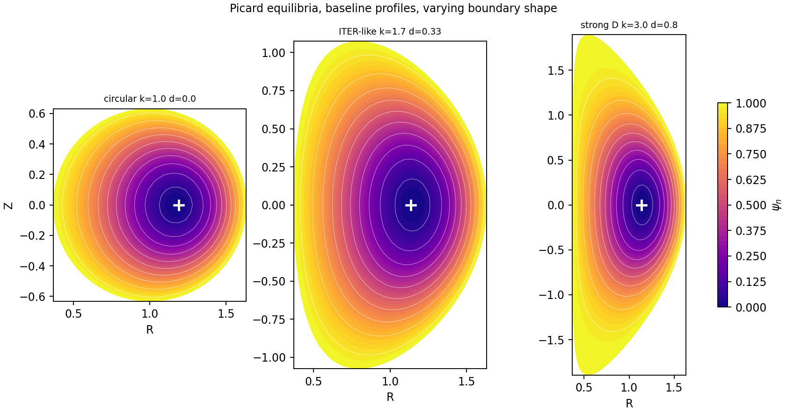
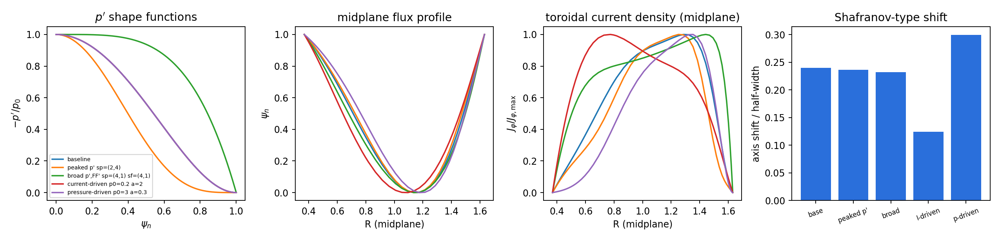
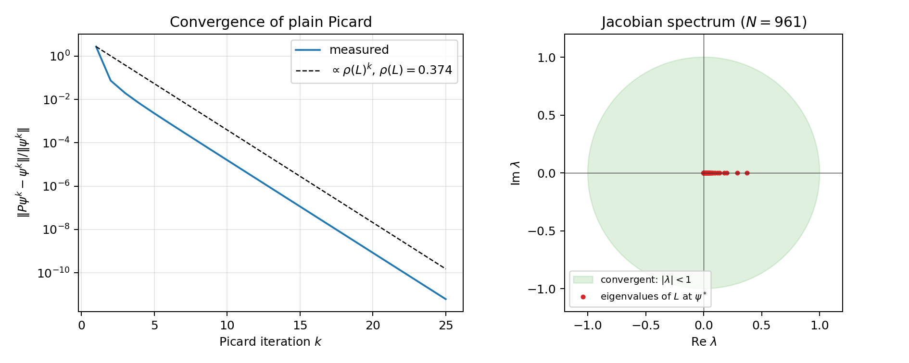

# Fixed-boundary Grad–Shafranov solver (tokamak equilibria)



Finite-difference Grad–Shafranov solver on a **boundary-fitted, non-homogeneous mesh**, with sparse linear algebra
and Picard iteration for the nonlinear case.

The numerical scheme follows López, Orozco & Dougar-Zhabon, *J. Phys.: Conf. Ser.* **1159**, 012017 (2019), who validate
only the **linear Solov'ev** case. This project reproduces that benchmark and goes further:

- **Nonlinear equilibria.** Arbitrary $p'(\psi)$ and $FF'(\psi)$ profiles are handled through Picard iteration, on Solov'ev
  and parametric D-shaped boundaries.
- **Validation of the nonlinear path.** The Solov'ev case is re-solved through the Picard path, and a nonlinear case is
  checked for grid convergence.
- **Convergence analysis.** The spectrum of the Picard Jacobian is computed at the fixed point, and its spectral radius
  predicts the observed number of iterations.
- **Physics of the solutions.** Profile and shape studies show how the current density and the Shafranov shift of the
  magnetic axis respond to pressure- and current-driven profiles.

The solver and the numerical studies were developed between February and May 2026 as a project for the Classical
Electrodynamics course at École Polytechnique; the documentation and the report were written up in November 2026. The
project was group work in which each member took a different part, and the solver in this repository, its implementation,
the mathematics behind it and the analysis were done independently.

**Full write-up:** [`docs/gs_solver.pdf`](docs/gs_solver.pdf) (LaTeX source in [`docs/gs_solver.tex`](docs/gs_solver.tex)):
context (what GS is, why it matters, fixed vs free boundary), the solver, the Solov'ev benchmark, nonlinear validation
and profiles, the Picard convergence analysis, and the full derivation of the equation in the appendix.

## Headline results
| Study | Result |
|---|---|
| Solov'ev benchmark | observed order ≈ 1.9; max error 1.8e-6 on the finest grid (54 289 unknowns), 7.0e-6 on a 233×233 grid (López: ≤ 1e-5 on 241×241) |
| Solov'ev through the Picard path | converges in 2 iterations, observed order ≈ 1.9 |
| Nonlinear cases (7 shapes/profiles) | plain Picard reaches residual ~1e-11 in 15–33 iterations, mesh-independent |
| Picard Jacobian spectrum | real, non-negative; $\rho(L) \in [0.22, 0.48]$, predicts the iteration count |
| Nonlinear grid convergence (amplitude functional) | converges, fitted order ≈ 1.2 (not second order) |

**Benchmark against the analytic Solov'ev equilibrium** (numerical, analytic, and their difference):


**Nonlinear equilibria**: profile shapes, midplane flux and current density, and the Shafranov shift of the magnetic axis:



**Convergence of the Picard iteration**: the measured residual decays at the rate set by the spectral radius of the
Jacobian, whose eigenvalues all lie on the real axis inside the unit disc:



## Layout
```
src/gs_solver.py          core solver (geometry, mesh, FD assembly, linear + Picard solvers, plots)
src/gs_fixedpoint.py      fixed-point residuals, dense Jacobian / eigenvalue tools
scripts/                  reproducible studies that generate figures/ and results/
   run_example.py             one Solov'ev + one nonlinear equilibrium
   benchmark_soloviev.py      linear benchmark, convergence study, mesh figures
   nonlinear_validation.py    Solov'ev via the Picard path; grid convergence of a nonlinear case
   profiles_nonlinear.py      shapes and (p', FF') profile gallery
   spectral_study.py          spectrum of the Picard Jacobian vs observed iteration counts
   profile_parametrisation_check.py   why the shapes are on p' and FF' (see below)
figures/  results/        outputs used in the report (PNG / JSON)
docs/                     written report LaTeX source + compiled pdf
```

## Quick start
```bash
pip install -r requirements.txt
python scripts/run_example.py            # one Solov'ev + one nonlinear equilibrium
python scripts/benchmark_soloviev.py
python scripts/nonlinear_validation.py
python scripts/profiles_nonlinear.py
python scripts/spectral_study.py
python scripts/profile_parametrisation_check.py
cd docs && latexmk -pdf gs_solver.tex
```
Options (geometry, physics mode, profile exponents, `ds`, …) are module-level variables at the top of
`src/gs_solver.py`; the scripts override them programmatically.

## Profiles
The shapes are imposed on the **derivatives**, so the source (hence the toroidal current density) is non-zero on the axis:

```math
-\frac{\mathrm{d}p}{\mathrm{d}\psi_n} = p_0\,\bigl(1-\psi_n^{s_{p1}}\bigr)^{s_{p2}},
\qquad
-\frac{\mathrm{d}F^2}{\mathrm{d}\psi_n} = \alpha\,\bigl(1-\psi_n^{s_{f1}}\bigr)^{s_{f2}},
\qquad
S = R^2 p_0\, p_{\mathrm{shape}} + \frac{\alpha}{2}\, f_{2,\mathrm{shape}} \ge 0 .
```
The exponents are `sp1, sp2, sf1, sf2` in the code. Only the ratio $p_0/\alpha$ matters for the normalised iteration.

## Iteration
Plain Picard. The stopping test is the fixed-point residual $\lVert P(\psi) - \psi \rVert / \lVert \psi \rVert$; every
nonlinear run reports it and warns if it is not small (and if the iteration looks like a period-2 cycle).

## References
López, Orozco & Dougar-Zhabon, *J. Phys.: Conf. Ser.* **1159**, 012017 (2019) — numerical scheme, Solov'ev benchmark ·
Jardin, *Computational Methods in Plasma Physics* (CRC Press, 2010) — Picard iteration ·
B. Dudson, *Plasma fluid theory* (YouTube lecture series) — derivation in the appendix.

## License
Released under the [MIT License](LICENSE).
