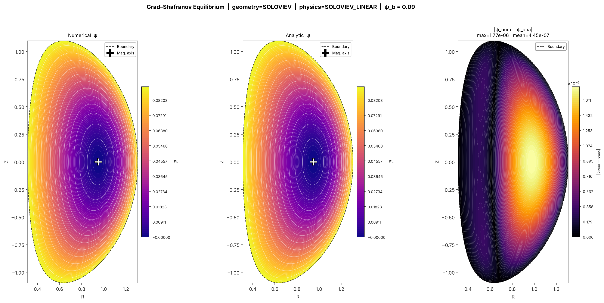
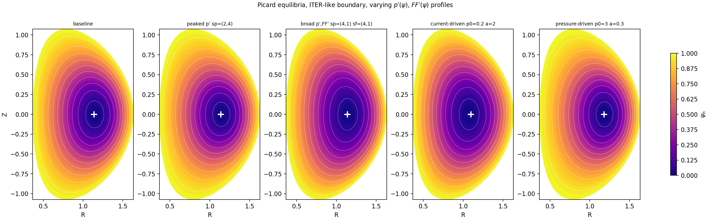

# Fixed-boundary Grad–Shafranov solver (tokamak equilibria)

Finite-difference Grad–Shafranov solver on a **boundary-fitted, non-homogeneous mesh**, with sparse linear algebra
and Picard iteration for the nonlinear case.

The numerical scheme follows López, Orozco & Dougar-Zhabon, *J. Phys.: Conf. Ser.* **1159**, 012017 (2019), who validate
the **linear Solov'ev** case. This project reproduces that benchmark and goes further: it also handles the **nonlinear**
case, i.e. arbitrary `p'(ψ)` and `FF'(ψ)`, via Picard iteration, and studies the spectrum of that iteration.

**Full write-up:** [`docs/gs_solver_report.pdf`](docs/gs_solver_report.pdf) (LaTeX source in `docs/paper/`):
context (what GS is, why it matters, fixed vs free boundary), the solver, the Solov'ev benchmark, nonlinear validation
and profiles, the Picard convergence analysis, and the full derivation of the equation in the appendix.

## Layout
```
src/gs_solver.py          core solver (geometry, mesh, FD assembly, linear + Picard solvers, plots)
src/gs_fixedpoint.py      fixed-point residuals, dense Jacobian / eigenvalue tools
scripts/                  reproducible studies that generate figures/ and results/
   benchmark_soloviev.py      linear benchmark, convergence study, mesh figures
   nonlinear_validation.py    Soloviev via the Picard path; grid convergence of a nonlinear case
   profiles_nonlinear.py      shapes and (p', FF') profile gallery
   spectral_study.py          spectrum of the Picard Jacobian vs observed iteration counts
   profile_parametrisation_check.py   why the shapes are on p' and FF' (see below)
figures/  results/        outputs used in the report (PNG / JSON)
docs/paper/               written report LaTeX source + compiled pdf
```

## Quick start
```bash
pip install -r requirements.txt
python scripts/run_example.py            # one Solov'ev + one nonlinear equilibrium
python scripts/benchmark_soloviev.py
python scripts/nonlinear_validation.py
python scripts/profiles_nonlinear.py
python scripts/spectral_study.py
python scripts/profile_parametrisation_check.py
cd docs/paper && latexmk -pdf gs_solver.tex
```
Options (geometry, physics mode, profile exponents, `ds`, …) are module-level variables at the top of
`src/gs_solver.py`; the scripts override them programmatically.

## Profiles
The shapes are imposed on the **derivatives**, so the source (hence the toroidal current density) is non-zero on the axis:

```
−dp/dψn      = p0    · (1 − ψn^sp1)^sp2
−d(F²)/dψn   = alpha · (1 − ψn^sf1)^sf2          S = R² p0 p_shape + (alpha/2) f2_shape ≥ 0
```
Only the ratio `p0/alpha` matters for the normalised iteration.

## Iteration
Plain Picard. The stopping test is the fixed-point residual `‖P(ψ) − ψ‖/‖ψ‖`; every nonlinear run reports it and warns if
it is not small (and if the iteration looks like a period-2 cycle).

## Headline results
| | |
|---|---|
| Solov'ev benchmark | observed order ≈ 1.9; max error 1.9e-5 (N=5041), 7.0e-6 on a 233×233 grid (López: ≤ 1e-5 on 241×241) |
| Solov'ev through the Picard path | converges in 2 iterations, observed order ≈ 1.9 |
| Nonlinear cases (7 shapes/profiles) | plain Picard reaches residual ~1e-11 in 15–33 iterations, mesh-independent |
| Picard Jacobian spectrum | real, non-negative; ρ(L) ∈ [0.22, 0.48], predicts the iteration count |
| Nonlinear grid convergence (amplitude functional) | converges, fitted order ≈ 1.2 (not second order) |




## Design note: why the profile shapes are on p' and FF'
Shaping `p` and `F²` and differentiating afterwards makes the source vanish on the magnetic axis (hollow current) for
exponents ≥ 2, and plain Picard then oscillates on a period-2 cycle (`‖Pψ−ψ‖/‖ψ‖ ≈ 0.11`, resolution-independent).
`scripts/profile_parametrisation_check.py` reproduces this against the default and two control cases.
Not covered: hollow-current / advanced scenarios, free boundary, comparison with a published nonlinear reference.

## References
López, Orozco & Dougar-Zhabon, *J. Phys.: Conf. Ser.* **1159**, 012017 (2019) — numerical scheme, Solov'ev benchmark ·
Jardin, *Computational Methods in Plasma Physics* (CRC Press, 2010) — Picard iteration ·
B. Dudson, *Plasma fluid theory* (YouTube lecture series) — derivation in the appendix.
